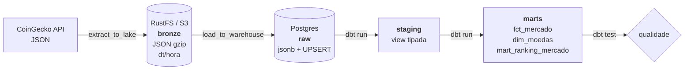

# Pipeline ELT — Mercado de Criptomoedas


Pipeline de engenharia de dados **de ponta a ponta**: extrai dados reais de uma API
pública, arquiva o bruto num data lake, carrega num data warehouse e transforma em
modelos analíticos testados — tudo orquestrado pelo Airflow e reproduzível com um
comando.

> **Fonte:** [CoinGecko API](https://www.coingecko.com/en/api) (top 100 moedas por
> valor de mercado). Não exige chave; com `COINGECKO_API_KEY` o limite de
> requisições aumenta.

---

## Arquitetura



| Camada | Tecnologia | Papel |
|---|---|---|
| **bronze** | RustFS (API S3) | JSON cru, imutável, particionado por `dt`/`hora`. Permite reprocessar sem chamar a API de novo. |
| **raw** | Postgres | O mesmo JSON em `jsonb`, com UPSERT idempotente por `ingested_at`. |
| **staging** | dbt (view) | Explode o JSON, tipa colunas e deduplica. Sem regra de negócio. |
| **marts** | dbt (tabelas) | Modelos prontos para consumo: fato incremental, dimensão e ranking. |
| **orquestração** | Airflow | DAG horária com retries, idempotência e testes como gate. |

### Por que ELT e não ETL?

O dado bruto é preservado no lake **antes** de qualquer transformação. Se uma regra
mudar, reprocessa-se o histórico inteiro sem depender da API — e a transformação
fica versionada em SQL (dbt), não escondida em código Python. Detalhes em
[`docs/decisoes.md`](docs/decisoes.md).

### E por que RustFS e não MinIO?

O MinIO encerrou o modelo open source e removeu as imagens públicas do Docker Hub —
um compose com `minio/minio` simplesmente não sobe mais. O **RustFS** é um
object storage compatível com S3, Apache 2.0, com imagem ativa e console web.
Como o código fala S3 genérico (`boto3`), trocar por AWS S3, R2 ou GCS é mudar
duas variáveis de ambiente — nenhuma linha de Python.

---

## Pré-requisitos

| Requisito | Como verificar |
|---|---|
| Docker Desktop (com WSL2) | `docker --version` |
| ~6 GB de RAM livres | — |
| Portas 8080, 9000, 9001, 5433 livres | — |

Sem Docker instalado (Windows):

```powershell
winget install -e --id Docker.DockerDesktop
```

Reinicie a máquina, abra o **Docker Desktop** e espere o ícone ficar verde.
Se o WSL2 ainda não estiver ativo: `wsl --install` e reinicie novamente.

---

## Como rodar

```powershell
# 1. entra no projeto
cd cripto-elt

# 2. sobe tudo (a primeira vez compila a imagem do Airflow: ~5–10 min)
.\scripts\start.ps1

# 3. abra o Airflow, ative a DAG e clique em "Trigger"
#    http://localhost:8080   →   admin / admin
```

A DAG `cripto_elt` roda **de hora em hora**. Para disparar agora, sem esperar o
relógio:

```powershell
docker compose exec airflow-scheduler airflow dags trigger cripto_elt
```

Acompanhe o log:

```powershell
.\scripts\logs.ps1
```

Parar / limpar:

```powershell
.\scripts\stop.ps1    # para, preserva os dados
.\scripts\reset.ps1   # apaga volumes (começa do zero)
```

### Acessos

| Serviço | URL | Credenciais |
|---|---|---|
| Airflow | http://localhost:8080 | `admin` / `admin` |
| Console do data lake | http://localhost:9001 | `admin` / `admin12345` |
| Postgres (warehouse) | `localhost:5433` | `dw` / `dw12345` / `warehouse` |

---

## Consultando os dados

Conecte com DBeaver, DataGrip ou `psql` em `localhost:5433` (db `warehouse`, user `dw`).

```sql
-- Top 10 por valor de mercado no último snapshot
select posicao, simbolo, nome, preco_usd, market_cap_usd,
       participacao_market_cap_pct, variacao_24h_pct
from marts.mart_ranking_mercado
order by posicao
limit 10;

-- Evolução do Bitcoin nas últimas 24 horas
select ingested_at, preco_usd, volume_24h_usd
from marts.fct_mercado
where moeda_id = 'bitcoin'
order by ingested_at desc
limit 24;

-- Quantos snapshots já foram carregados
select count(*) as snapshots, min(ingested_at), max(ingested_at)
from marts.fct_mercado;
```

Mais consultas em [`sql/consultas_exemplo.sql`](sql/consultas_exemplo.sql).

---

## Estrutura do repositório

```
cripto-elt/
├── docker-compose.yml          # Airflow + Postgres (x2) + RustFS
├── .env.example                # todas as variáveis, com defaults seguros
├── docker/airflow/
│   ├── Dockerfile              # imagem do Airflow + dbt + boto3
│   └── requirements.txt
├── dags/
│   └── cripto_elt.py           # DAG: extract → load → dbt run → dbt test
├── etl/
│   ├── config.py               # configuração via variáveis de ambiente
│   ├── coingecko.py            # cliente HTTP, contrato e validações
│   ├── storage.py              # escrita/leitura no lake (S3)
│   └── warehouse.py            # DDL e UPSERT idempotente no Postgres
├── dbt/
│   ├── dbt_project.yml
│   ├── profiles.yml            # conexão lida de env vars
│   ├── models/staging/         # stg_coingecko__mercado + sources + testes
│   ├── models/marts/           # fct_mercado, dim_moedas, ranking
│   └── tests/                  # testes singulares (unicidade, preço, cobertura)
├── sql/init/                   # schemas criados na subida do Postgres
├── scripts/                    # start / stop / reset / logs (PowerShell)
└── tests/                      # testes unitários do Python (pytest)
```

---

## Qualidade

**Na extração (Python):** o contrato de dados é explícito. Registro sem `id`,
`current_price`, `market_cap` ou `last_updated` é descartado; snapshot com menos de
50 moedas, ids duplicados ou preço ≤ 0 **falha a task** — nada de lixo entra no lake.

**No warehouse (dbt):**

- `not_null` nas chaves e nas métricas principais
- `unique` nas dimensões (`dim_moedas`, `mart_ranking_mercado`)
- testes singulares: sem duplicatas por `(ingested_at, moeda_id)`, preço positivo e
  cobertura mínima de 50 moedas por snapshot
- `freshness` na fonte: alerta se o dado tiver mais de 6 h (erro após 24 h)

**Testes unitários:**

```powershell
python -m venv .venv
.\.venv\Scripts\Activate.ps1
pip install -r requirements-dev.txt
pytest -q
```

---

## Decisões de arquitetura (resumo)

| Decisão | Motivo |
|---|---|
| `ingested_at` = `data_interval_start` da DAG | Reprocessar a mesma hora faz UPSERT, não duplica |
| XCom carrega só a chave do objeto | Evita inflar o banco de metadados do Airflow |
| dbt em vez de pandas | Transformação versionada, testável e com linhagem |
| Lake separado do warehouse | Lake guarda o cru; warehouse guarda o modelado |
| Configuração `S3_*` genérica | Troca de fornecedor sem tocar em código |
| Segredos só por env var | Nada de senha no código; pronto para Secrets Backend |

Discussão completa: [`docs/decisoes.md`](docs/decisoes.md).

---

## Problemas comuns

| Sintoma | Causa / solução |
|---|---|
| `port is already allocated` | Outra instância ocupando 8080/9000/9001/5433. `.\scripts\stop.ps1` e tente de novo. |
| DAG falha com `429` | Rate limit da CoinGecko. Reduza a frequência ou configure `COINGECKO_API_KEY`. |
| `permission denied` em `logs/` | `docker compose down`, apague a pasta `logs`, suba de novo. |
| DAG não aparece no Airflow | Aguarde ~30 s (o scheduler lê as DAGs em ciclo) e confira `docker compose logs airflow-scheduler`. |
| Primeira execução muito lenta | É o build da imagem do Airflow + download das dependências. Só na primeira vez. |

---

## Roadmap

- [ ] Particionar `fct_mercado` por data e adicionar retenção do bronze
- [ ] Alertas no Slack/e-mail em falha de DAG ou teste
- [ ] Camada de BI (Metabase) consumindo `marts`
- [ ] CI com `dbt build --empty` + lint de SQL (sqlfluff)
- [ ] Migrar o orquestrador para Airflow 3 (Task SDK)

---

## O que este projeto demonstra

- Modelagem em camadas (medallion) com separação clara de responsabilidades
- Ingestão idempotente e *replayable* — o problema real de todo pipeline
- Contratos de dados e validação na fronteira
- dbt com modelos incrementais, testes e documentação
- Orquestração com retries, dependências e falha segura
- Infraestrutura reproduzível (`docker compose up`) sem passo manual
